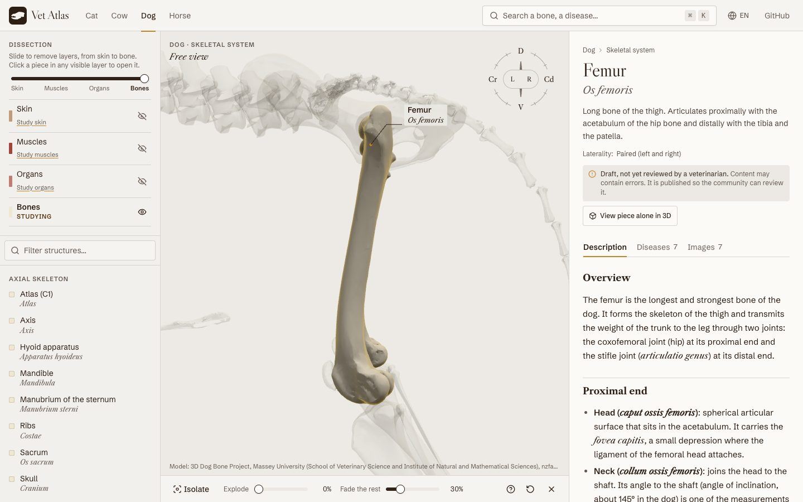

<div align="center">

# Vet Atlas

**Open 3D veterinary anatomy, built for studying**

A free atlas of dog, cat, cow and horse anatomy. Every bone, muscle and organ is
a selectable piece with its Latin (NAV) name, a description, the diseases that
affect it and real images.

[](https://vet-atlas.ketbome.com)
[](LICENSE)
[](LICENSE-CONTENT.md)
[](https://github.com/Ketbome/vet-atlas/actions/workflows/pages.yml)

[Open the atlas](https://vet-atlas.ketbome.com) · [En español](https://vet-atlas.ketbome.com/es/) · [Report an error](https://github.com/Ketbome/vet-atlas/issues/new) · [Contribute](CONTRIBUTING.md)

</div>

---

<div align="center">
  
</div>
<div align="center" style="margin-top: 8px;">
  <a href="https://buymeacoffee.com/pims2711y" target="_blank">
    
  </a>
  <br>
  <span style="font-size: 0.95em; color: #888;">Vet Atlas is free and stays free. If it helps you study, a coffee keeps it going. Thank you!</span>
</div>

---

## What's inside

| | |
|---|---|
| **Species** | Dog, cat, cow, horse |
| **Systems** | Skin, muscles, organs and skeleton, stacked as dissection layers |
| **Structures** | ~340, each with its NAV name in Latin |
| **Diseases** | ~125, linked to the structures they affect, with references |
| **Images** | ~190 specimens, radiographs and histology, all with license and attribution |
| **Languages** | English and Spanish |

- **Dissect** from skin to bone with one slider, or show any layer as a ghost.
- **Click any piece** in the model to open its entry; the selection is the URL, so every view can be shared.
- **Search** any structure or disease in either language with `⌘K` / `/`.
- **Anatomical views** (lateral, dorsal, cranial…) from the orientation rose, plus isolate and explode.
- Works on a phone, no account, no ads.

Every entry shows its review status: **draft**, **based on sources** (checked against the references listed at its end) or **reviewed** by a veterinarian, and lists its sources at the end. It is study material, not a substitute for diagnosis or veterinary consultation.

## Run it locally

```bash
git clone https://github.com/Ketbome/vet-atlas.git
cd vet-atlas
pnpm install
pnpm dev
```

| Command | What it does |
|---|---|
| `pnpm dev` | Dev server (English at `/`, Spanish at `/es`) |
| `pnpm build` | Static export to `out/` |
| `pnpm validate` | Content integrity and GLB mesh names |
| `pnpm lint` · `pnpm typecheck` | Lint and types (run `pnpm next typegen` first) |
| `pnpm models:<species>[-<system>]` | Rebuild a species' GLBs (needs `SKETCHFAB_TOKEN`) |

## How it works

Next.js 16 static export served by GitHub Pages, no database and no server.
Content is plain files under `content/` (JSON + MDX) validated with Zod; the
viewer is React Three Fiber with one GLB per species and system, where each mesh
is one structure.

```
app/[locale]/        routes: home, species, system viewer, structure, disease
components/viewer/   3D viewer: scene, layers, camera, structure tree
components/atlas/    site chrome, search, MDX, badges
content/             species, systems, structures, diseases, media, sources
lib/content/         Zod schemas, loaders, search index
scripts/             model builds, content validation, CT tooling
messages/            UI strings per locale
```

## Contributing

You don't need to touch code to help. Every page has an **Edit on GitHub** link
that opens the right file:

- **Fix or translate a text**: edit the `.mdx`, open a pull request.
- **Add a structure or a disease**: a folder with `meta.json` and one `.mdx` per language.
- **Review as a veterinarian**: check an entry and flip `review.status` to `reviewed`.

Details in [CONTRIBUTING.md](CONTRIBUTING.md).

## Credits and licenses

Code is [MIT](LICENSE). Text written for the project is
[CC BY-SA 4.0](LICENSE-CONTENT.md). Third-party models and images keep their
original license and are credited next to each item on the site.

The 3D models come from open collections by Massey University, VetAgro Sup,
Ontario Veterinary College, the Royal Veterinary College, the University of
Edinburgh, Cornell University, the University of Minnesota, the University of
Granada, the University of Sarajevo, RISD Nature Lab, MorphoSource and
independent Sketchfab artists. The full list with licenses is in
[`content/sources.json`](content/sources.json).

Vet Atlas is non-commercial: no ads, no paid tiers, no accounts.
